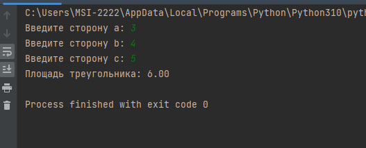
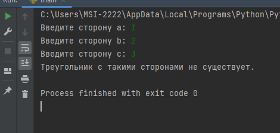
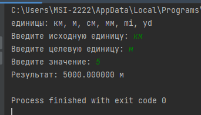
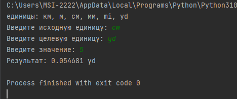
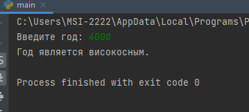
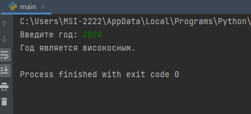
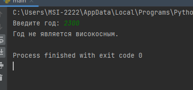

# Лабораторная работа №1 – Функции ввода/вывода, условный оператор

## Исполнитель

фон Браун Сергей Александрович  
Группа ФТ-250008

Дисциплина: «Прикладное программирование»

## Среда разработки

Язык программирования: Python 3.10.  
Среда разработки: PyCharm.

## Задание 1 – Площадь треугольника

Программа вычисляет площадь треугольника по трём сторонам по формуле Герона с точностью до сотых. Если треугольника с такими сторонами не существует, выводится сообщение об этом.

### Инструкция по работе

По запросу программы необходимо по очереди ввести стороны треугольника a, b и c (числа, можно дробные).

### Результаты тестирования

**Тест 1.** Стороны 3, 4, 5. Ожидаемый результат: площадь 6.00.

**Тест 2.** Стороны 1, 2, 3. Треугольник не существует, так как сумма двух сторон не больше третьей.

## Задание 2 – Конвертер расстояний

Программа переводит расстояние из одной единицы измерения в другую. Поддерживаются единицы: километры (км), метры (м), сантиметры (см), миллиметры (мм), мили (mi), ярды (yd). Результат выводится с шестью знаками после запятой. Если введена неизвестная единица, выводится сообщение об ошибке.

### Инструкция по работе

По запросу программы необходимо ввести исходную единицу, затем целевую единицу и после этого числовое значение. Единицы вводятся так, как они указаны в списке выше (км, м, см, мм, mi, yd).

### Результаты тестирования

**Тест 1.** 5 км в метры. Ожидаемый результат: 5000.000000 м.

**Тест 2.** 5 см в ярды. Ожидаемый результат: 0.054681 yd.

## Задание 3 – Високосный год

Программа определяет, является ли введённый год високосным. Год високосный, если он делится на 400, либо делится на 4, но не делится на 100.

### Инструкция по работе

По запросу программы необходимо ввести год (целое число).

### Результаты тестирования

**Тест 1.** Год 4000 делится на 400. Ожидаемый результат: високосный.

**Тест 2.** Год 2028 делится на 4, но не делится на 100. Ожидаемый результат: високосный.

**Тест 3.** Год 2300 делится на 100, но не делится на 400. Ожидаемый результат: не високосный.

